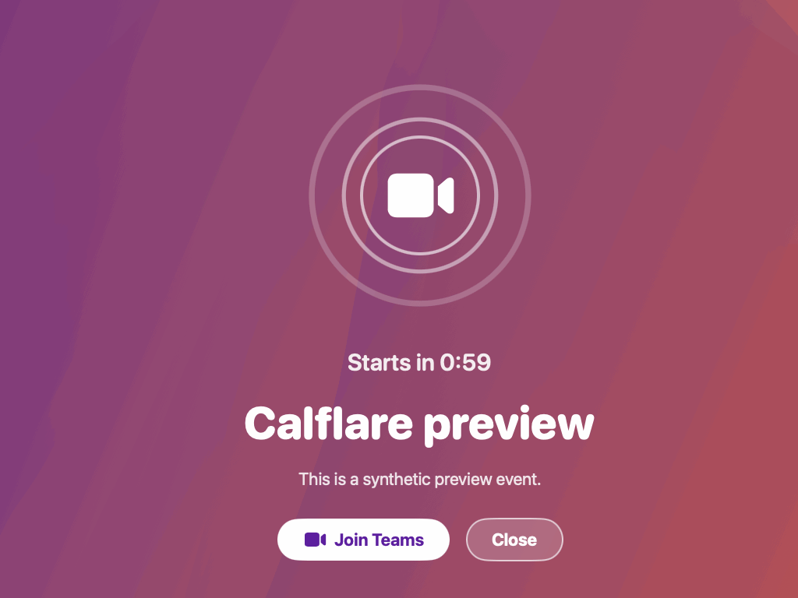

<p align="center">
  
</p>

<h1 align="center">Calflare</h1>

<h3 align="center">Never miss an appointment again!</h3>

<p align="center">
  <a href="https://github.com/amaury-d/calfare/actions/workflows/ci.yml"></a>
  <a href="https://github.com/amaury-d/calfare/releases/latest"></a>
  
  
  <a href="LICENSE"></a>
</p>

<p align="center">
  
</p>

Calflare is a local macOS meeting reminder. A minute before an event starts it
takes over every screen with an animated full-screen alert, so a meeting cannot
quietly slip past you. It reads calendars through Apple's Calendar framework
(EventKit) and never talks to Outlook or Microsoft Graph; an Outlook account
works as long as its calendars are visible to macOS Calendar.

## Features

- **A full-screen alert** on every display, about a minute ahead, with a live
  countdown. `Escape` dismisses it.
- **One-click Teams join** when a Teams link is found in the event.
- **Pick your calendars** from the menu bar, grouped by account. No UUIDs, no
  text editor.
- **Launch at login**, either from the window or through the installed
  LaunchAgent.
- **Entirely local.** No telemetry, no network calls, no Graph API. Event
  details never leave your Mac.
- **English and French**, following your macOS language.
- **Quiet by design.** It skips all-day, cancelled and declined events, and
  never alerts twice for the same occurrence.

## Install

Requires macOS 14 or later, with calendar accounts already set up in macOS.

### Download

Grab the latest `Calflare-*.zip` from the
[releases page](https://github.com/amaury-d/calfare/releases/latest), unzip it,
and move `Calflare.app` to `~/Applications`. The build is ad-hoc signed and not
notarized, so macOS quarantines the download:

```sh
xattr -dr com.apple.quarantine ~/Applications/Calflare.app
open ~/Applications/Calflare.app
```

Then enable **Launch at login** in the window so Calflare comes back after a
restart.

### Build from source

Needs Xcode Command Line Tools with Swift 5.9 or later.

```sh
make install
```

This builds the app, installs it at `~/Applications/Calflare.app`, and loads a
per-user LaunchAgent that keeps Calflare running in the menu bar, where it
checks your calendars every 20 seconds. To choose a different application
directory, use `make install INSTALL_DIR="/path/to/apps"`; use the same
directory for uninstallation. Allow Calflare to access Calendars when prompted,
or in System Settings > Privacy & Security > Calendars.

The LaunchAgent does three things the **Launch at login** switch cannot, which
is why `make install` remains the sturdier option for a reminder you rely on:

- **It restarts Calflare if it crashes**, within seconds. A login item only
  starts the app at login, so a crash would mean no alerts until the next one.
- **It writes logs** to `~/Library/Logs/Calflare/`, which is what `make logs`
  reads. Started as a plain login item, Calflare's output goes nowhere.
- **It marks the process interactive**, so macOS does not throttle the
  20-second timer the way it can for an idle background app.

Use `make` or `make app` to build and ad-hoc sign a self-contained
`build/Calflare.app` without accessing calendars, showing a window, or loading
a service. Ad-hoc signing is intended for local source builds and does not
guarantee that macOS will retain permission after a rebuild. To upgrade, run
`make install` again rather than only `make`: it replaces the LaunchAgent too.

## Menu bar

Calflare shows a "C" icon in the menu bar. Its menu has three entries:

- **Calendars…** opens the Calflare window: which calendars trigger alerts, and
  whether Calflare starts at login. Opening the app again (from the Finder or
  `open`) shows the same window.
- **Test an alert** shows a synthetic full-screen alert, the same as
  `make preview` or `CalflareAgent --test`. It needs no Calendar access.
- **Quit Calflare** stops Calflare and its alerts. It is not relaunched
  automatically; run `make restart` (or `launchctl kickstart
  gui/$(id -u)/com.calflare.agent`) or log out and back in to start it again.
  An alert already on screen stays open.

## Launch at login

The **Startup** section of the window has a **Launch at login** switch, which
registers Calflare as a login item. That covers starting at login and nothing
more: for crash recovery and logs, install from source instead.

Move `Calflare.app` into `~/Applications` **before** turning it on. macOS
records where the app is, so enabling it while the app still sits in your
Downloads folder, in a disk image, or in Gatekeeper's read-only translocation
would register a path that no longer exists at the next login. Calflare refuses
to register from those locations instead of failing silently later.

When you installed with `make install`, the switch is already on and read-only:
the LaunchAgent starts Calflare at login, and `make uninstall` removes it.
Calflare never writes or deletes that file itself. If you switch Calflare off
in System Settings > General > Login Items & Extensions, the window says so
rather than claiming it still starts.

Because source builds are ad-hoc signed, the app's code identity changes with
every build. Calflare re-registers itself on launch when it detects a new
version, so a stale login item does not stop it from starting.

`CalflareAgent --login-item-status`, `--enable-login-item` and
`--disable-login-item` do the same from a terminal.

## Choose which calendars trigger alerts

By default, Calflare uses all calendars macOS makes available. To limit alerts
to specific calendars:

1. Click the Calflare icon in the menu bar and choose **Calendars…**.
2. Tick the calendars you want, listed under the account they belong to. Each
   change is saved immediately and applies within about 20 seconds.

**All calendars** includes calendars you add later. Unticking one calendar
while it is on freezes the selection to the calendars that exist right now.
Turning **All calendars** off, or unticking every calendar, disables alerts
entirely. A calendar saved in the selection but temporarily unavailable, for
example because its account is offline, is kept rather than dropped. If the
window says Calflare needs Calendar access, use its button to allow it or to
open System Settings.

## Behavior and limitations

- Runs as a menu bar app and checks every 20 seconds. `CalflareAgent --once`
  performs a single check and exits, for diagnostics. While running, it prints
  `eventkit-alerts=N` to `stdout.log` only when an alert was shown.
- Alerts for eligible timed events 45–85 seconds
  away. This is an approximate one-minute warning, not a precise alarm.
- Skips all-day, cancelled, and declined events, including titles prefixed
  with common English or French cancellation/decline markers.
- Displays the title and location on each display. `Return` joins only when a
  Teams link was detected; `Escape` closes the alert. Other meeting providers
  are not detected. Alerts dismiss automatically after 15 minutes.
- Stores occurrence-based deduplication keys for seven days in
  `~/Library/Application Support/Calflare/alerted-events.txt`.
- A sleeping Mac may miss an event: Calflare does not wake the computer. It
  checks again as soon as the Mac wakes, so an alert may be slightly late.

## Privacy and troubleshooting

Calflare has no telemetry and makes no Graph API requests. Event details are
read locally through EventKit. Calendar identifiers and deduplication state
are stored locally. The meeting destination is opened only when the user
activates the Teams button in an alert.

The Calflare window shows when Calendar access is missing and links to the
right System Settings pane. If calendars are missing from it, confirm the
account exposes calendars to macOS Calendar and that Calflare has Calendar
permission. The account need not be Exchange specifically. Run `make logs` to
follow the LaunchAgent output, or inspect the files in
`~/Library/Logs/Calflare/`. These files grow over time; they may be removed
when no longer needed.

## Uninstallation

```sh
make uninstall
```

This stops and removes only Calflare's LaunchAgent, its login item, and the
installed app.
Configuration, deduplication state, and logs remain in your home directory.
To remove those data files as well, do so explicitly after uninstalling:

```sh
rm -rf "$HOME/Library/Application Support/Calflare"
rm -rf "$HOME/Library/Logs/Calflare"
```

## Development and license

See [CONTRIBUTING.md](CONTRIBUTING.md) for tests and packaging checks.
Calflare is available under the [MIT license](LICENSE).
